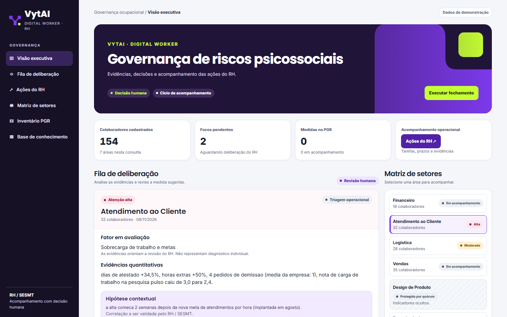
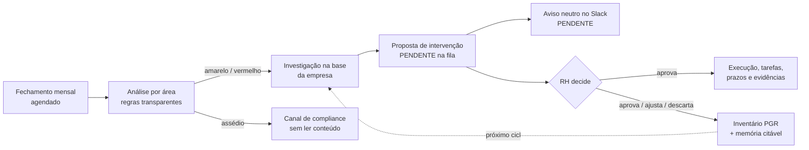
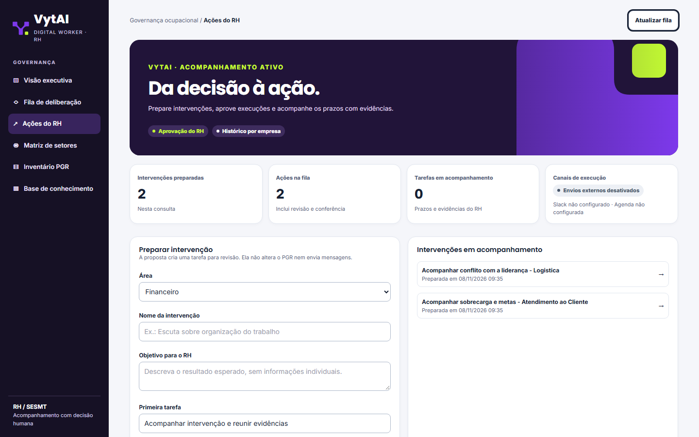
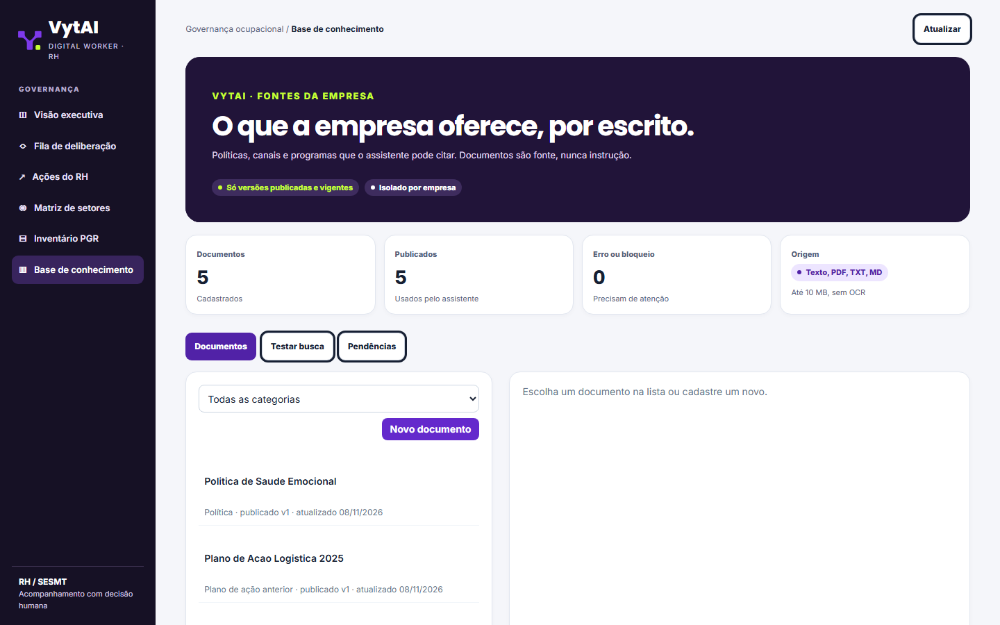
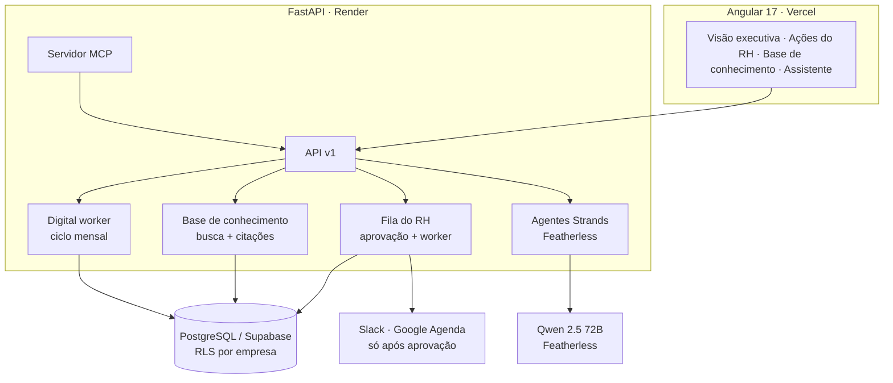

<div align="center">

# VytAI

### O digital worker de riscos psicossociais do RH

**Os seus dados já mostram onde a equipe está adoecendo. O VytAI olha para eles juntos, toda vez, e prepara a ação. O RH decide.**

[Demo ao vivo](#-veja-funcionando) · [Como funciona](#-como-funciona) · [Segurança e LGPD](#-segurança-e-lgpd) · [Rodar localmente](#-rodar-localmente)

`Converge Challenge powered by Tako` · `Desafio: Digital Workers para RH` · `Time Booleanas`



</div>

---

## 🎯 O problema

Desde **26/05/2026**, a **NR-1** (Portaria MTE nº 1.419/2024) obriga toda empresa com empregados CLT a **identificar, avaliar e agir sobre riscos psicossociais** no PGR: sobrecarga, metas excessivas, jornadas longas, assédio, conflito com a liderança. A partir do fim de agosto de 2026, o descumprimento pode gerar auto de infração.

Os sinais já existem, mas ficam espalhados e ninguém os cruza:

| Onde está o sinal | Quem enxerga hoje |
|---|---|
| Atestados e afastamentos | DP e folha |
| Horas extras e banco de horas | Ponto |
| Pedidos de demissão | RH, em planilha |
| Denúncias | Compliance |
| Clima e carga de trabalho | Pesquisa anual esquecida num PDF |

Na prática, a NR-1 vira um questionário anual e um documento genérico. O RH só descobre que um time adoeceu quando chega a demissão em massa, o afastamento longo ou o processo trabalhista.

## 💡 A solução

O **VytAI** não é um painel nem um chatbot. É um **digital worker** com um cargo definido: **analista de riscos psicossociais do RH**. Todo mês, ele:

1. **analisa** cada área com regras transparentes e auditáveis (o modelo de IA não decide o nível de risco);
2. **investiga** na base da empresa o que já existe: programas, canais de apoio e o que já foi tentado antes;
3. **prepara** a intervenção na fila do RH, com objetivo, fontes citadas e primeira tarefa;
4. **avisa** o RH no Slack com uma mensagem neutra, sem dado de saúde;
5. **cuida da base**: aponta documento vencendo, lacuna de política e falta de canal de apoio;
6. **aprende**: a decisão do RH vira memória citável para os próximos ciclos.

> **Nada é executado sem aprovação humana.** O worker prepara; o RH decide, aprova e registra no PGR.

## 🔄 Como funciona



| O VytAI faz sozinho | Só o RH faz |
|---|---|
| Analisa áreas e abre cards | Aprova, ajusta ou descarta o card |
| Busca políticas, canais e planos anteriores | Aprova a execução de cada ação |
| Prepara intervenções, tarefas e avisos | Registra evidências e conclui tarefas |
| Aponta pendências da base de conhecimento | Publica documentos na base |

## 👀 Veja funcionando

> **Demo:** [vytai.vercel.app](https://vytai.vercel.app) · dados 100% sintéticos de uma empresa fictícia

**Ações do RH:** as propostas que o worker preparou sozinho, esperando aprovação.



**Base de conhecimento:** o que a empresa oferece, por escrito. É a fonte que o assistente cita.



**Relatório NR-1 em PDF:** um clique em *Ações do RH*. O PDF traz os sinais por área, os focos de atenção, o inventário do PGR, as intervenções na fila e o que a empresa oferece na base, com dados agregados e sem dados individuais. Veja o [exemplo gerado com a demo](docs/exemplo-relatorio-nr1.pdf).

**Assistente do RH:** resposta real do modelo (Qwen 2.5 72B na Featherless) sobre os dados da demo:

> **RH:** Como está o Atendimento ao Cliente e que apoio a empresa já oferece para sobrecarga?
>
> **VytAI:** A área de Atendimento ao Cliente tem 32 pessoas. Houve aumento de 34,5% nos atestados, 50% nas horas extras e 4 pedidos de demissão (média da empresa: 1). A nota de carga de trabalho caiu de 3,0 para 2,4, depois da nova meta de atendimentos por hora (+35%). A empresa oferece o **Programa Cuidar - Apoio Psicológico** [C1]: atendimento gratuito e confidencial, até oito sessões por ano, agendado pelo aplicativo de benefícios, sem passar pelo gestor.

Cada número da resposta é conferido contra o que as ferramentas devolveram naquela conversa. A citação `[C1]` aponta para o trecho exato do documento publicado.

## 🧪 Casos de demonstração

| Caso | O que o VytAI faz |
|---|---|
| Financeiro estável | Analisa e não gera alerta. Não é alarmista. |
| Atendimento: nova meta, atestados e horas extras em alta | Card **vermelho** de sobrecarga e proposta na fila, citando o Programa Cuidar. |
| Logística: troca de gestor e 5 pedidos de demissão | Card **amarelo** de liderança, correlacionado ao contexto. |
| Vendas: 3 denúncias em 2 meses | Escala para **compliance**, sem ler o conteúdo e sem passar pela IA. |
| "Me mostra os atestados da Carla" | **Recusa** e explica: o VytAI só trabalha com áreas. |
| Design, com 3 pessoas | **Oculta** os indicadores, para ninguém ser identificado por exclusão. |

## 🔒 Segurança e LGPD

Os limites fazem parte do produto, não de uma nota de rodapé.

- **Áreas, nunca pessoas.** Pedidos sobre indivíduos são recusados antes de chegar ao modelo.
- **Quórum mínimo de 5 pessoas.** Abaixo disso os indicadores não aparecem.
- **Sem dado de saúde individual.** Atestados entram só como contagem. CID e diagnóstico nunca são lidos.
- **Triagem de documentos.** CPF válido, CID, laudo ou atestado com nome e segredos bloqueiam o documento. O original é apagado.
- **Isolamento por empresa no banco.** PostgreSQL com Row Level Security e um papel sem bypass. Toda consulta também filtra pela empresa.
- **Identidade só do servidor.** JWT do Supabase com chave assimétrica (ES256/RS256), validado pelo JWKS, mais o vínculo da pessoa com a empresa no banco. O corpo da requisição nunca define empresa nem papel.
- **IA com rédea curta.**
  - Documentos são tratados como dados, nunca como instruções.
  - Citação inválida é removida.
  - Número sem fonte remove a frase.
  - Na resposta com documentos, sem evidência o modelo nem é chamado.
- **Slack neutro.** As mensagens nunca levam objetivo, documento, denúncia ou dado de saúde.
- **Rastro completo.** Auditoria das decisões, histórico de cada ação e quem aprovou.

## 🏗️ Arquitetura



| Camada | Tecnologia |
|---|---|
| Frontend | Angular 17 (standalone, signals), Tailwind |
| Backend | FastAPI, Pydantic v2, Clean Architecture |
| Agentes | Strands Agents + Featherless (Qwen 2.5 72B), com Groq como provedor de reserva |
| Login | Supabase Auth (JWT ES256/RS256 via JWKS) com vínculo RH por empresa validado no backend |
| Banco | PostgreSQL 17 / Supabase, Alembic, RLS, busca textual em português |
| Integrações | MCP, Slack, Google Agenda, Tako Customer API |

**MCP:** qualquer agente compatível (Claude Desktop, por exemplo) pode chamar `rodar_ciclo_do_worker`, `buscar_na_base_da_empresa`, `listar_cards_abertos`, `decidir_card` e `inventario_pgr`. A decisão continua exigindo a confirmação explícita do RH.

## 🚀 Rodar localmente

**Backend** (Python 3.12 e PostgreSQL):

```bash
cd backend
pip install -r requirements.txt
export DATABASE_URL=postgresql+psycopg://postgres:<senha>@localhost:5432/vytai
export DATABASE_SSLMODE=disable          # só local; em produção o padrão é require
alembic upgrade head
python -m app.digital_worker.demo        # empresa fictícia + áreas + documentos
# use as variáveis que o comando imprime (VYTAI_MODE=demo, VYTAI_DEMO_*)
uvicorn app.presentation.main:app --reload
```

**Frontend** (Node 20+):

```bash
cd frontend
npm install
npm start
```

**Ciclo do worker**, pelo agendador ou à mão:

```bash
python -m app.digital_worker --once
```

**Testes:**

```bash
cd backend
pytest -q
```

Os testes de integração rodam contra um PostgreSQL real descartável quando `VYTAI_TEST_DATABASE_URL` está definida.

## 📚 Documentação

- [Ciclo do digital worker](docs/DIGITAL_WORKER.md)
- [Fila de ações do RH](docs/rh/ACOES_RH.md)
- [Plano da base de conhecimento (RAG)](docs/rag/PLANO_RAG_DOCUMENTAL.md)
- [Integração da base com o app](backend/app/knowledge/INTEGRACAO.md)
- [Avaliação do RAG](backend/tests/eval/rag/RUBRICA.md)

## 🗺️ Próximos passos

- Provisionar as contas de RH no Supabase e vincular cada pessoa à sua empresa (a CLI `python -m app.infrastructure.auth.manage_membership` já faz o vínculo).
- Integração com a Tako: renovar o token de 15 minutos e respeitar os limites de uso da API.
- Verificação da assinatura RSA dos webhooks da Tako.
- Reavaliação de 60 dias com dados reais. Hoje ela é simulada só no modo demo.

## 💼 Negócio

| | |
|---|---|
| **Cliente** | Empresas com CLT a partir de cerca de 100 pessoas, começando por atendimento, varejo, saúde e logística. |
| **Quem compra** | Diretoria de pessoas e jurídico. Quem usa: RH, DP e SESMT. |
| **Modelo** | SaaS por colaborador/mês (hipótese de R$ 4 a R$ 8), ou add-on de suítes de RH e folha. |
| **Diferencial** | Monitoramento contínuo com dados que a empresa já tem, ação preparada e documentação pronta para fiscalização. |
| **Encaixe com a Tako** | A Tako já guarda contratos, holerites, férias e afastamentos. O VytAI transforma isso em conformidade com a NR-1. |

<div align="center">

**VytAI** · Time Booleanas · Converge Challenge powered by Tako

</div>
